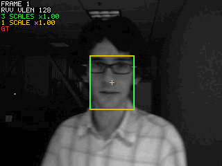

# RISC-V_CV

A RISC-V image-processing library (`vec::` kernels) with a scalar reference
implementation (`ref::`), unit tests, and benchmarks. The whole project
cross-compiles to RISC-V and builds **two images per test/benchmark**:

- **gem5** — bare-metal `.bin` images linked against the
  [nexus-am](https://github.com/OpenXiangShan/nexus-am) abstract-machine
  runtime, run on the **XiangShan gem5 fork** (XS-GEM5) for cycle-accurate
  simulation.
- **qemu-user** — static Linux ELFs (`<name>_qemu`) run under
  `qemu-riscv64` user-mode for fast functional validation.

## KCF tracker on RISC-V Vector

<p align="center">
  
</p>

The whole KCF flow (K1–K6 with the RVV kernels, 3 scales per detect) tracking OTB *David*
(471 frames, 320x240) under `qemu-riscv64 -cpu max,vlen=128`. The boxes and text are drawn
on RISC-V too; the host only encodes the video. **Red** = ground truth, **green** = 3 scales,
**yellow** = 1 scale (the paper). Full-quality video:
[`out_video/video_rvv_s3.mp4`](out_video/video_rvv_s3.mp4) ·
[how to make it](#tracking-video-on-qemu)

| Tracker | Precision@20px | Mean centre error | Mean IoU | Success (IoU > 0.5) |
| --- | ---: | ---: | ---: | ---: |
| 3 scales | 100.0 % | 4.06 px | 0.792 | 100.0 % |
| 1 scale | 100.0 % | 8.54 px | 0.535 | 60.5 % |

### Scalar vs RVV on XS-GEM5

Cycles and instructions **per frame** (average of the 2 timed frames in
`images/kcf_seq.hpp`, David 320x240), 1 scale per detect, KMHV3 model. *Scalar* = every
`ref::` kernel (`KCF_Kn_VEC=0`, compiled without GCC auto-vectorization); *RVV* = every
`vec::` kernel (the default). [How to run it](#benchmark-the-flow-on-gem5-scalar-vs-rvv)

| Kernel | Scalar cycles | Scalar instr | Scalar % flow | RVV cycles | RVV instr | RVV % flow | Cycles speedup | Instr reduction |
| --- | ---: | ---: | ---: | ---: | ---: | ---: | ---: | ---: |
| K1_subwindow | 661,698 | 2,140,304 | 5.5% | 359,268 | 154,384 | 15.0% | 1.84x | 13.86x |
| K2_gradient | 2,130,439 | 4,084,775 | 17.7% | 274,963 | 248,730 | 11.5% | 7.75x | 16.42x |
| K3_histogram | 589,232 | 2,247,705 | 4.9% | 435,182 | 193,830 | 18.2% | 1.35x | 11.60x |
| K4_norm_pca_hann | 2,175,946 | 3,614,154 | 18.0% | 145,190 | 163,390 | 6.1% | 14.99x | 22.12x |
| layout_to_planar | 188,261 | 329,752 | 1.6% | 0 | 0 | 0.0% | N/A | N/A |
| K5_spectra_31fft | 3,097,043 | 16,341,502 | 25.7% | 847,724 | 826,372 | 35.5% | 3.65x | 19.77x |
| K5_detect | 1,945,579 | 3,188,044 | 16.1% | 153,755 | 99,097 | 6.4% | 12.65x | 32.17x |
| K6_peak | 3,311 | 6,407 | 0.0% | 821 | 350 | 0.0% | 4.03x | 18.31x |
| K5_train | 1,276,311 | 3,103,752 | 10.6% | 170,609 | 95,316 | 7.1% | 7.48x | 32.56x |
| other | 1,273 | 509 | 0.0% | 1,395 | 510 | 0.1% | 0.91x | 1.00x |
| **Flow total** | **12,069,093** | **35,056,904** | **100.0%** | **2,388,910** | **1,781,979** | **100.0%** | **5.05x** | **19.67x** |

- *Cycles speedup* = scalar cycles / RVV cycles; *Instr reduction* = scalar instructions / RVV
  instructions.
- `layout_to_planar` runs only with the scalar K4: the RVV K4 writes the planar layout K5
  needs by itself.
- `other` = moving the box, timer reads and the calls between stages (on gem5 also the m5ops).

### Side experiment: HOG cell size 4, 8 and 16

The paper and the tables above use 4-pixel HOG cells. This side experiment runs the same RVV flow
with 8- and 16-pixel cells. The template size T grows a little (136 → 144 → 160) so it still splits
into whole cells, and the FFT grid shrinks from 32×32 to 16×16 and 8×8. It is a separate run from
the tables above, so its cell-4 column does not match them exactly.

**Tracking accuracy** (OTB *David*, 471 frames, `qemu-riscv64`)

| | Cell 4 (T=136) | Cell 8 (T=144) | Cell 16 (T=160) |
| --- | :---: | :---: | :---: |
| Grid: K3 / FFT | 34×34 / 32×32 | 18×18 / 16×16 | 10×10 / 8×8 |
| QEMU time (471 frames) | 307.5 s | 182.1 s | 133.6 s |
| Precision@20px, 3 scales | 100.0 % | 100.0 % | 100.0 % |
| Mean centre error, 3 scales | 4.17 px | 5.43 px | 5.84 px |
| Mean IoU, 3 scales | 0.781 | 0.683 | 0.485 |
| Success (IoU > 0.5), 3 scales | 100.0 % | 94.7 % | 34.6 % |
| Precision@20px, 1 scale | 100.0 % | 100.0 % | 100.0 % |
| Mean centre error, 1 scale | 8.46 px | 7.54 px | 6.00 px |
| Mean IoU, 1 scale | 0.535 | 0.539 | 0.535 |
| Success (IoU > 0.5), 1 scale | 60.5 % | 61.6 % | 61.8 % |

### Comment : 
1- All three configurations keep precision@20px at 100% \
2- with 3 scales, IoU drops from 0.781 (cell 4) to 0.485 (cell 16), because an 8×8 response map cannot discriminate scale windows that differ by only 5% (scale_step 1.05) \
3- The single-scale rows act as a control: IoU ≈ 0.535 for all cell sizes, set by the target shrinking to ~0.75× of its initial size late in the sequence, independent of features. \

**XS-GEM5, RVV flow, per frame** (cycles with their share of the flow, then retired instructions)

| Kernel | Cell 4 cycles | Cell 8 cycles | Cell 16 cycles | Cell 4 instr | Cell 8 instr | Cell 16 instr |
| --- | ---: | ---: | ---: | ---: | ---: | ---: |
| K1_subwindow | 347,139 (13.6%) | 386,385 (22.2%) | 461,624 (20.5%) | 154,384 | 172,120 | 210,392 |
| K2_gradient | 353,657 (13.8%) | 291,140 (16.7%) | 359,184 (15.9%) | 258,518 | 263,354 | 324,922 |
| K3_histogram | 541,003 (21.2%) | 762,418 (43.7%) | 1,315,777 (58.4%) | 185,338 | 248,056 | 370,378 |
| K4_norm_pca_hann | 146,385 (5.7%) | 31,101 (1.8%) | 6,283 (0.3%) | 163,390 | 41,578 | 10,840 |
| K5_spectra_31fft | 840,310 (32.9%) | 195,942 (11.2%) | 89,327 (4.0%) | 826,372 | 191,492 | 87,580 |
| K5_detect | 151,860 (5.9%) | 37,323 (2.1%) | 8,929 (0.4%) | 99,097 | 24,153 | 8,153 |
| K6_peak | 1,011 (0.0%) | 699 (0.0%) | 661 (0.0%) | 350 | 237 | 179 |
| K5_train | 171,085 (6.7%) | 37,279 (2.1%) | 10,490 (0.5%) | 95,316 | 23,468 | 7,316 |
| other | 1,544 (0.1%) | 1,704 (0.1%) | 1,700 (0.1%) | 510 | 510 | 510 |
| **Flow total** | **2,553,995** | **1,743,994** | **2,253,978** | **1,783,275** | **964,968** | **1,020,270** |

- K4 and K5 work on the cell grid, so they shrink with it: K5 spectra (31 FFTs) drops from 840,310
  cycles to 195,942 (4.3x less) and 89,327 (9.4x less).
- K1, K2 and K3 work on the template pixels, which grow with T. K3 also gets slower per pixel
  (14.6 → 18.4 → 25.7 cycles per pixel per call), so it becomes the biggest stage: 43.7 % of the
  flow with 8-pixel cells and 58.4 % with 16.
- Cell 8 is the fastest flow: 1.46x fewer cycles than cell 4 (about 1,720 instead of 1,175 simulated
  fps at 3 GHz). The price is box accuracy with 3 scales: mean IoU 0.781 → 0.683, success
  100 % → 94.7 %.
- Cell 16 is slower than cell 8 (because of K3) and loses most of the box accuracy (IoU 0.485,
  success 34.6 %).
- Precision@20px is 100 % in every case, so centre error alone does not separate the three. The IoU
  with 3 scales does, because it also scores the box size.
- With 1 scale the box keeps its first-frame size, so IoU and success stay about the same
  (≈ 0.535 and ≈ 61 %) for every cell size.

## Prerequisites

- CMake >= 3.22.
- A GNU RISC-V cross toolchain providing `riscv64-linux-gnu-g++` (GCC 13+
  recommended; the build is validated with GCC 15).
- A checkout of **nexus-am** (provides the `am`/`klib` bare-metal runtime).
- A built **XS-GEM5** (`build/RISCV/gem5.opt`) and its `configs/example/kmhv3.py`.
- **QEMU user-mode** — `qemu-riscv64` from Debian/Ubuntu `qemu-user` (see
  [`SETUP.md`](SETUP.md) for the apt line).

If you don't have nexus-am, XS-GEM5, or QEMU yet, [`SETUP.md`](SETUP.md) walks
through the whole thing from an empty machine: host packages, cloning nexus-am
and XS-GEM5, building DRAMsim3 and gem5, then this project.

## Build

```bash
cmake -S . -B build \
  -DCMAKE_TOOLCHAIN_FILE=cmake/riscv64_xs_toolchain.cmake \
  -DNEXUS_AM_HOME=$HOME/nexus-am -DGEM5_HOME=$HOME/GEM5
cmake --build build -j8
```

This cross-compiles the library, the unit tests, and the benchmarks. Each
test/benchmark produces a gem5 bare-metal `.bin` (via objcopy) and a static
Linux ELF `<name>_qemu`. The nexus-am `am`/`klib` archives are built
automatically as part of the build, so they always match the configured
architecture and `-march`.

If `AM_HOME` / `XIANG_GEM5` are already set in your environment (as the
reference setup does), you can omit the `-D` flags entirely:

```bash
cmake -S . -B build -DCMAKE_TOOLCHAIN_FILE=cmake/riscv64_xs_toolchain.cmake
cmake --build build -j8
```

## Run 

**gem5** (cycle-accurate):

```bash
cmake --build build --target run_<app_name>_gem5
```

**qemu-user** (fast functional):

```bash
cmake --build build --target run_<app_name>_qemu
```

gem5 pass/fail is detected from the test summary regex (gem5 does not
propagate the guest's exit code). qemu-user tests use the guest exit code
directly (no PASS/FAIL regex).

Single unit-test
```bash
cmake --build build --target run_Add_test_qemu   # fast functional
cmake --build build --target run_Add_test_gem5   # cycle-accurate
```

All unit-tests
```bash
cmake --build build --target run_unit_tests_qemu   # fast functional
cmake --build build --target run_unit_tests_gem5   # cycle-accurate
```

Benchmark
```bash
cmake --build build --target run_Add_benchmark_gem5   # cycle-accurate
cmake --build build --target run_Add_benchmark_qemu   # fast functional
```

Benchmarks report cycle and retired-instruction counts on gem5 (milliseconds are
meaningless on a cycle-level simulator). Each gem5 run writes a raw UART log to
`build/<dir>/<target>.log` and gem5 stats to `build/<dir>/<target>-m5out/`.
Each qemu run tees to `build/<dir>/<target>.log` (e.g. `unit_tests_qemu.log`).

## Configuration variables

All install locations and flags are CMake cache variables, so anyone can point
the build at their own toolchain / nexus-am / gem5 / QEMU without editing the
build files. Pass them with `-D<VAR>=value` at configure time.

| Variable | Default | Meaning |
| --- | --- | --- |
| `NEXUS_AM_HOME` | `$AM_HOME`, else `~/nexus-am` | nexus-am checkout |
| `GEM5_HOME` | `$XIANG_GEM5`, else `~/GEM5` | XS-GEM5 checkout |
| `GEM5_BINARY` | `${GEM5_HOME}/build/RISCV/gem5.opt` | gem5 binary |
| `GEM5_CONFIG` | `${GEM5_HOME}/configs/example/kmhv3.py` | gem5 config script |
| `GEM5_EXTRA_ARGS` | `--disable-difftest` | Extra gem5 config arguments |
| `QEMU_BINARY` | `qemu-riscv64` on PATH | qemu-riscv64 user-mode emulator |
| `QEMU_CPU` | `max` | QEMU `-cpu` (default `max` for RVV + bitmanip/crypto) |
| `QEMU_EXTRA_ARGS` | (empty) | Extra qemu-riscv64 arguments |
| `RISCV_TOOLCHAIN_PREFIX` | `riscv64-linux-gnu-` | GNU toolchain triple prefix |
| `AM_ARCH` | `riscv64-xs` | nexus-am target architecture |
| `RISCV_MABI` | `lp64d` | RISC-V `-mabi` |
| `RISCV_MARCH` | `rv64gcv_zba_zbb_zbc_zbs_zbkb_zbkc_zbkx_zknd_zkne_zknh_zkr_zksed_zksh_zkt` | RISC-V `-march` |


## How it works

- **Cross-compile** — `cmake/riscv64_xs_toolchain.cmake` selects the GNU RISC-V
  compilers and shared flags (`-static -mcmodel=medany -fno-rtti
  -fno-exceptions ...`). Freestanding-only flags (`-ffreestanding`, `-fno-builtin`,
  etc.) are applied per-target via `RISCV_BAREMETAL_COMPILE_FLAGS` on bare-metal
  images and libraries only.
- **Two image kinds** — bare-metal images link nexus-am's `am`/`klib` and
  objcopy to `.bin` for gem5. qemu-user images are static Linux ELFs built
  without nexus-am; `riscv_port.hpp` routes I/O to glibc when `RISCV_BAREMETAL`
  is not defined.
- **Bare-metal runtime** — under `RISCV_BAREMETAL`, the library
  (`lib/include/riscv_port.hpp`, `lib/source/riscv_runtime.cpp`) provides
  `operator new`/`delete` over klib's `malloc`/`free`, a `__cxa_pure_virtual`
  trap, cycle counters (`csrr cycle`/`instret` in `lib/include/riscv_timer.hpp`),
  and a static-constructor runner. nexus-am's runtime predates C++: it never
  runs `.init_array` and only enables the FPU, so the runtime enables the vector
  unit (`MSTATUS_VS`) and runs static constructors explicitly. A self-contained
  linker script (`cmake/riscv_init_array.ld`, a copy of nexus-am's
  `loader64.ld`/`section.ld` plus a `KEEP()`ed `.init_array`) keeps those
  constructors from being garbage-collected.
- **Link** — `riscv_add_baremetal_image(<source.cpp>)` creates the executable
  and objcopies the ELF to a raw `.bin`. Callers link `${PROJECT_NAME}` and
  `reference`, then the `riscv_baremetal_runtime` INTERFACE library, which
  supplies `am-${AM_ARCH}.a` and `klib-${AM_ARCH}.a` inside `--start-group`
  (the two archives reference each other) plus bare-metal link options.
- **Unit tests** — real GoogleTest cannot link against klib's bare-metal
  runtime, so `test/framework/include/gtest_lite.hpp` provides a minimal
  self-registering subset (`TEST`, `TEST_P`, `ASSERT_EQ`, `Values`, `Combine`,
  `INSTANTIATE_TEST_SUITE_P`, `RUN_ALL_TESTS`) with gtest-style output that
  ctest can match on.
- **Run on gem5** — `riscv_add_gem5_run(<target>)` takes the bare-metal
  executable target (e.g. `unit_tests_gem5`) and creates a `run_<target>` custom
  target plus a ctest entry (unless `RISCV_GEM5_NO_CTEST` is set on the target).
  The `.bin` path comes from the `RISCV_GEM5_BIN` property set by
  `riscv_add_baremetal_image`. Pass/fail regexes come from target properties
  `RISCV_GEM5_PASS_REGEX` / `RISCV_GEM5_FAIL_REGEX`.
- **Run on qemu-user** — `riscv_add_qemu_run(<target>)` takes the Linux ELF
  target (e.g. `unit_tests_qemu`) and creates `run_<target>` plus a ctest entry
  that runs the ELF under `qemu-riscv64`; ctest uses the guest exit code.

## Image I/O

- **qemu-user** — `Image::Read("in.pgm")` and `Image::Write("out.pgm")` use hosted
  libc to read/write PGM (P2/P5) and PPM (P3/P6). Writes are always binary P5/P6.
- **gem5** — no file I/O on the bare-metal runtime. Images are compiled in as
  headers (`scripts/image_to_header.py`) and loaded with
  `Image::Read(width, height, data)`. `Write` is not supported on gem5.

See [IMAGEIO.md](IMAGEIO.md) for formats and examples.

## KCF tracker

The K1–K6 reference kernels (`test/reference`) connected into one tracking step, run two ways:
accuracy on qemu-user, cycles on gem5.

| File | What it is |
| --- | --- |
| `test/reference/include/KCF_flow.hpp`, `test/reference/source/KCF_flow.cpp` | the flow: `ref::kcf_setup`, `ref::kcf_flow_init` (frame 1) and `ref::kcf_flow` (detect + train, one frame). Kernels only, no I/O |
| `example/source/kcf_tracker.cpp` | qemu-user only: a whole PGM sequence, writes the boxes, scores them (`kcf_tracker_qemu`) |
| `benchmark/source/KCF_benchmark.cpp` | gem5: times `ref::kcf_flow` per kernel and in total (`KCF_benchmark_gem5`) |
| `example/source/kcf_video.cpp` | qemu-user only: the flow on a PGM sequence, draws the boxes into a raw video (`kcf_video_qemu`) |
| `scripts/kcf_sequence.py` | a sequence → PGM folder (qemu) and/or compiled-in frames header (gem5) |
| `scripts/kcf_video.sh` | runs `kcf_video_qemu` under qemu and encodes the mp4 (+ the README GIF with `GIF=`) |
| `scripts/readme_gif.sh` | the GIF shown at the top of this README, from the raw frames or the mp4 |
| `images/kcf_seq.hpp` | 3 frames of OTB David, compiled into the gem5 image |
| `lib/include/riscv_math.hpp`, `lib/source/riscv_math.cpp` | the math functions the kernels need on bare metal (klib has none) |

Per frame, `ref::kcf_flow` runs:

```
detect at the old centre:  K1 -> K2 -> K3 -> K4 -> layout -> K5 spectra -> K5 detect -> K6
move the box by the K6 peak
train at the new centre:   K1 -> K2 -> K3 -> K4 -> layout -> K5 spectra -> K5 train
```

### Test sequences (`~/kcf_test`)

Every qemu run below starts from a real OTB sequence, so download the test sequences once,
before any qemu execution. The tools read one folder per sequence in the KCFcpp layout:

- `images.txt`: one frame path per line
- `region.txt`: the first box (8 comma-separated polygon coordinates, VOT format)
- `groundtruth.txt`: the ground-truth box for every frame

A sequence taken straight from the OTB site (`img/` + `groundtruth_rect.txt`) is not in this
layout. `get_test_seqs.py` from `kcf_scalar/tools` downloads three real OTB sequences (about
14 MB, needs internet) and writes them in this layout:

```bash
sudo apt install python3 python3-pil       # Pillow, also used by scripts/kcf_sequence.py
mkdir -p ~/kcf_test
python3 kcf_scalar/tools/get_test_seqs.py ~/kcf_test/seqs
ls ~/kcf_test/seqs/real_david              # should list images.txt, region.txt, groundtruth.txt
```

The rest of this section uses `~/kcf_test/seqs/real_david` (David, 471 frames, 320x240). Any
other folder in the same layout works the same way.

### Accuracy and boxes on qemu-user

Reads PGM frames from a folder made from one of the test sequences:

```bash
python3 scripts/kcf_sequence.py ~/kcf_test/seqs/real_david --pgm images/kcf_seq_pgm
cmake --build build --target run_kcf_tracker_qemu
# another folder: -DKCF_SEQ_DIR=/path at configure time, or run the ELF with the folder:
qemu-riscv64 -cpu max,vlen=128 build/example/kcf_tracker_qemu /path/to/pgm_folder
```

It prints the box and centre error per frame and precision@20px, and writes
`output_scalar.txt` into the folder (x,y,w,h per frame) for `eval.py` and `make_video.py`
from `kcf_scalar/tools`. It is not built for gem5 (it reads files).

### Benchmark the flow on gem5 (scalar vs RVV)

gem5 has no file I/O, so the frames are compiled in: `images/kcf_seq.hpp` (3 frames of David)
is already in the repo. Frame 1 trains the model (not timed); every next frame runs one
`ref::kcf_flow` under the timer.

Which version of each kernel the flow runs is chosen at configure time with `KCF_FLOW_DEFS`
(it sets the `KCF_Kn_VEC` macros of `KCF_flow.cpp`; all `1` = RVV by default), so use one
build folder per configuration. Frame 1 plus two flows need more instructions than XS-GEM5's
default `--maxinsts` (40 M), hence the `GEM5_EXTRA_ARGS`.

**RVV** (every `vec::` kernel):

```bash
cmake -S . -B build_rvv \
  -DCMAKE_TOOLCHAIN_FILE=cmake/riscv64_xs_toolchain.cmake \
  -DNEXUS_AM_HOME=$HOME/nexus-am -DGEM5_HOME=$HOME/GEM5 \
  -DGEM5_EXTRA_ARGS="--disable-difftest;--maxinsts=2000000000"
cmake --build build_rvv --target run_KCF_benchmark_gem5 -j8
```

**Scalar baseline** (every `ref::` kernel):

```bash
cmake -S . -B build_scalar \
  -DCMAKE_TOOLCHAIN_FILE=cmake/riscv64_xs_toolchain.cmake \
  -DNEXUS_AM_HOME=$HOME/nexus-am -DGEM5_HOME=$HOME/GEM5 \
  -DGEM5_EXTRA_ARGS="--disable-difftest;--maxinsts=2000000000" \
  -DKCF_FLOW_DEFS="KCF_K1_VEC=0;KCF_K2_VEC=0;KCF_K3_VEC=0;KCF_K4_VEC=0;KCF_K5_VEC=0;KCF_K6_VEC=0"
cmake --build build_scalar --target run_KCF_benchmark_gem5 -j8
```

Each run prints cycles and instructions per frame, then the per-kernel table (cycles/frame,
instructions/frame, calls, share of the flow) and `Output is correct.` when every timed frame
is within 20 px of the ground truth. The two tables are the two halves of the
[results above](#scalar-vs-rvv-on-xs-gem5). The output lands in:

- `build_<cfg>/benchmark/KCF_benchmark_gem5.log` — the UART output (the tables)
- `build_<cfg>/benchmark/KCF_benchmark_gem5-m5out/stats.txt` — gem5 stats, one section per
  stage; the `section n = frame f, stage` list at the end of the log maps them

Variations:

- One kernel at a time, e.g. everything RVV except K1: `-DKCF_FLOW_DEFS="KCF_K1_VEC=0"`.
- Multi-scale detect: `-DKCF_BENCH_SCALES=3` (1, 3, 5 or 7; default 1 = the paper).
- Another sequence: `python3 scripts/kcf_sequence.py SEQ_DIR --header images/kcf_seq.hpp --frames 3`.
- Functional check without gem5: `cmake --build build_rvv --target run_KCF_benchmark_qemu`
  (same code; its counters are host ticks, not cycles).

`REFERENCE_SCALAR_ONLY` (ON) compiles the `ref::` kernels with `-fno-tree-vectorize
-fno-tree-slp-vectorize`, so the scalar baseline really is scalar.

### Tracking video on qemu

`kcf_video_qemu` runs the flow (RVV kernels, 3 scales per detect by default) on a PGM
sequence and draws every frame with its boxes on RISC-V; `scripts/kcf_video.sh` runs it
under `qemu-riscv64` and encodes the frames into an mp4 with `ffmpeg` on the host. Needs
`qemu-riscv64`, `ffmpeg` and Pillow.

1. **PGM frames** (once). `images/kcf_seq_pgm/` is in `.gitignore`, so make it from an
   OTB/VOT-style sequence folder (`images.txt`, `region.txt`, `groundtruth.txt`). Download the
   sequences first if you have not yet: [Test sequences](#test-sequences-kcf_test).

   ```bash
   python3 scripts/kcf_sequence.py ~/kcf_test/seqs/real_david --pgm images/kcf_seq_pgm
   ```

2. **Build** the app (configure `build` as in [Build](#build); it is a qemu-only target):

   ```bash
   cmake --build build --target kcf_video_qemu -j8
   ```

3. **Run and encode.** The demo at the top of this page is exactly this command:

   ```bash
   sh scripts/kcf_video.sh build images/kcf_seq_pgm out_video --compare
   ```

   It writes into `out_video/`: `video_rvv_s3.mp4` (red = ground truth, green = 3 scales,
   yellow = 1 scale from `--compare`), `boxes_rvv_s3.txt` (x,y,w,h per frame),
   `track_rvv_s3.csv` (per frame: box, winning scale, K6 peak per scale, error, IoU) and
   `kcf_video.log` (a box every 25 frames and the scores in the table above).

   Options after the folders go to the app: `--scales 1` (the paper; files become
   `*_rvv_s1.*`), `--frames 100`, `--no-video`. Environment: `VLEN` (default 128),
   `QEMU` (default `qemu-riscv64`), `FPS` (default 30), `ZOOM` (default 2).

4. **README GIF.** Add `GIF=` to make the GIF from the lossless frames in the same run (exact
   box colours; this is how `docs/kcf_video.gif` was made), or convert an existing mp4:

   ```bash
   GIF=docs/kcf_video.gif sh scripts/kcf_video.sh build images/kcf_seq_pgm out_video --compare
   sh scripts/readme_gif.sh out_video/video_rvv_s3.mp4 docs/kcf_video.gif
   ```

   GitHub does not play an mp4 from the repo inside a README, which is why the page shows a
   GIF and links the mp4.
